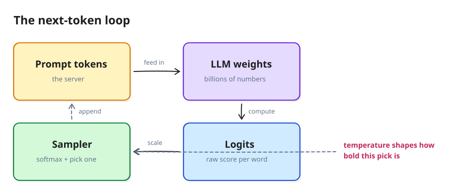
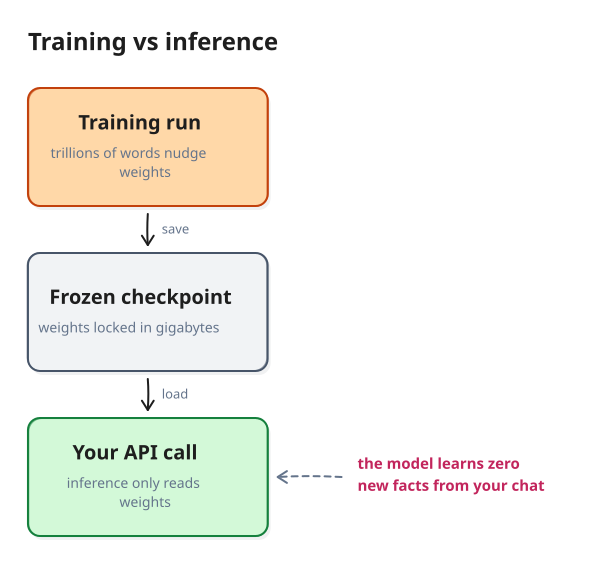
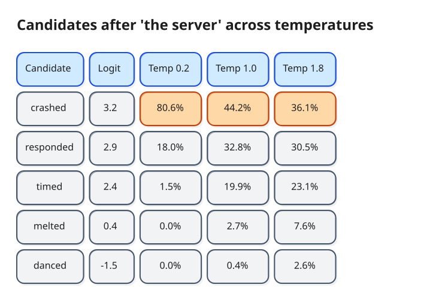

# What an LLM actually is
*What is the model really doing when it answers you?*
> **In one line:** An LLM does not look up answers or plan sentences; it scores every possible next piece of text, picks one, appends it to your prompt, and forgets it ever ran.

## Why this matters to you as a builder

An LLM is a computer program that takes a sequence of text and scores what single piece of text should come next. It exists because human language is too messy for handwritten rules, but predictable enough when compressed into billions of numbers.

- **You stop asking it to plan backwards.** Because tokens come out left-to-right, asking for a verdict on line one and the reasoning on line ten forces the model to guess a verdict first and rationalize it second.
- **You debug non-determinism in seconds.** When a test passes four times and fails on the fifth, you know whether sampling temperature or prompt drift caused the branch.
- **You stop expecting it to remember yesterday's request.** Every call hits frozen weights; if a fact is not in those weights or in your current prompt payload, it does not exist.

## The everyday version: autocomplete with a whole library compressed inside

Think of your phone keyboard suggesting three words above the keys. Your phone looks at the last word or two and offers a tiny menu.

A **large language model** in plain words: a neural network trained on massive text that scores every token in its vocabulary for what comes next. Instead of looking at two words, it looks at your whole prompt at once. Instead of picking from three common words, it scores 100,000+ pieces of text in parallel, picks one, glues that piece onto the end of your input, and runs the exact same loop again.

*Every generated token gets glued back onto the prompt for the very next pass.*

## Level 1: The six terms you actually need

Before we trace the arithmetic, let's lock in the vocabulary without circular definitions.

- **next-token prediction** in plain words: the core task of guessing the single next piece of text given all previous pieces.
- **parameters** in plain words: the adjustable numeric dials inside the model that determine how input text turns into output scores.
- **weights** in plain words: the exact numbers stored in those parameters after training finishes (a 7B model is literally a file holding seven billion floating-point numbers).
- **training** in plain words: the expensive upfront process of showing the model trillions of text examples and nudging its weights whenever it guesses the next token poorly.
- **inference** in plain words: running the finished, frozen model on your prompt to generate new tokens without changing any weights.

*Training moves the weights once at huge cost. Inference freezes them and just multiplies.*

## Level 2: How one answer is actually built

When you send `the server` to an LLM, four concrete steps happen inside one tick of the loop:

1. **Forward pass produces raw logits.** Your tokens flow through the frozen weights. At the very end, the model outputs one raw, unnormalized number for every entry in its vocabulary. We call these **logits** in plain words: raw scores the model assigns to each possible next token before turning them into percentages.
2. **Temperature scales the gap between scores.** We divide every logit by **temperature** in plain words: a dial that controls how sharply the highest-scoring tokens dominate the probability list. In our lab, `crashed` has logit `3.2` and `responded` has `2.9`.
3. **Softmax turns scores into probabilities.** We exponentiate the scaled logits and divide by their sum (**softmax** in plain words: a math step that converts any list of raw numbers into positive probabilities that add up to 100%). At temperature `0.2`, `crashed` takes `80.6%` of the probability mass. At temperature `1.0`, `crashed` drops to `44.2%` and `responded` gets `32.8%`.
4. **Sample one token and append.** The sampler rolls a weighted die. If it picks `responded`, the new input becomes `the server responded`, and the whole machine runs again for token four.

*Real percentages from our lab run: low temperature locks onto the top score, high temperature spreads mass.*

## Level 3: Pro mode — what this rules out in production

Understanding that an LLM is strictly a forward-only next-token predictor immediately explains three failure modes that burn engineering teams:

1. **The early-token trap (snowballing hallucinations).** If you ask `'Answer YES or NO first, then explain why'`, and at temperature `1.0` the sampler rolls a 20% token (`YES`), every subsequent pass sees `YES` in its prompt context. The model's job is to predict likely text following `YES`, so it invents an argument for `YES` even when the facts point to `NO`. Fix: always ask the model to reason *before* emitting the final verdict token.
2. **No built-in scratchpad between tokens.** The model does the same fixed amount of arithmetic per token whether the next word is `'the'` or the answer to a 5-digit multiplication. If a calculation requires ten intermediate steps, those steps must be written out as visible tokens in the context.
3. **Temperature 0 is greedy, not 'more factual'.** Setting temperature to `0.0` (**greedy decoding** in plain words: always picking the single highest-probability token at every step) makes runs repeatable (`1 / 5` unique outputs in our lab), but if the highest-probability phrase is a common misconception, greedy decoding will repeat that misconception 100% of the time.

## Jargon Decoder

| Term | In plain words | Why you care |
|---|---|---|
| **large language model (LLM)** | A neural network trained on massive text that scores every possible next piece of text. | Frames the tool properly: it is a pattern-completion engine, not a database. |
| **next-token prediction** | Guessing the single next piece of text given all the pieces before it. | Explains why word order in your prompt changes quality: the model cannot plan backwards. |
| **parameters** | The adjustable numeric dials inside the network architecture. | More parameters (8B vs 70B) mean more capacity to store subtle patterns, at higher RAM and latency cost. |
| **weights** | The frozen floating-point values stored inside the parameters after training. | Weights are read-only during your API call; the model never updates its weights from your prompt. |
| **training** | Showing the model trillions of tokens and updating weights to reduce prediction error. | Where the model's cutoff date and baseline world knowledge come from. |
| **inference** | Running a prompt through frozen weights to generate tokens. | What you actually pay for per million tokens in production. |
| **logits** | Raw, unnormalized scores the model outputs for every token in its vocabulary. | Every decoding trick (temperature, top-p, JSON schemas) works by editing logits before sampling. |
| **softmax** | Exponentiating logits and dividing by the total so all probabilities sum to 100%. | Shows why a slightly higher logit still leaves room for runner-up tokens to be picked. |
| **temperature** | A divisor applied to logits before softmax that flattens or sharpens the probabilities. | Your primary lever between repeatable deterministic output (0.0) and diverse sampling (1.0+). |

## Hands-On Lab: Build the 40-line next-token predictor & diff 5 runs across temperatures

See with your own eyes how raw logits turn into probabilities under temperature 0.2, 1.0, and 1.8, and why temperature 0.0 produces 1 unique output across 5 runs while temperature 1.0 produces 5 distinct trajectories.
