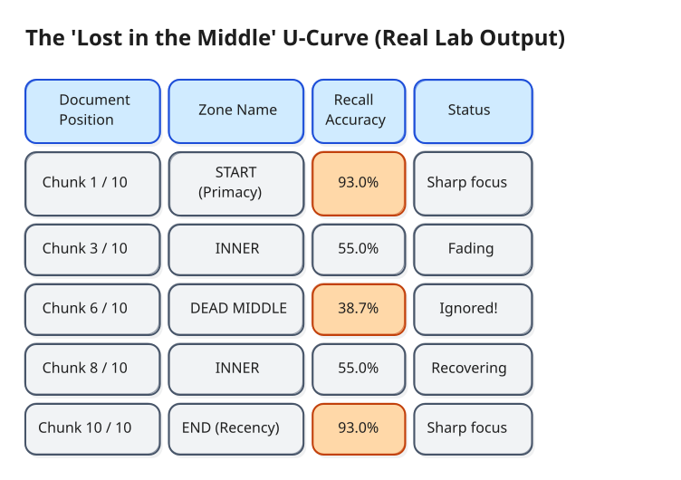

# The context window is your whole memory
*Where does the model keep what you told it two messages ago?*
> **In one line:** An AI has zero memory of your previous message; your chat app secretly pastes your entire conversation history onto a fixed-size lunch tray on every single turn — and anything that falls off the tray or sits in the dead middle gets forgotten.

## Explain it like I'm 12: The Amnesia Chef and the Fixed-Size Lunch Tray

Remember from Lesson 1 that the AI's neural weights are frozen on disk? The moment an LLM finishes replying to you, it has **100% amnesia**. The model itself is completely **stateless** — it stores zero memory of your chat inside its weights.

Then how does a chat app remember what you said three turns ago? Because the app pulls off a sleight-of-hand trick: every time you hit **Send**, your client silently packs `System Rules + Turn 1 + Reply 1 + Turn 2 + Reply 2 + Your New Message` into one giant array and sends the entire script from scratch on a fixed-size tray called the **context window**.

**What shares the tray?** Everything! Your system prompt, tool/JSON schemas, retrieved RAG documents, chat history, **the model's visible reply**, *and* any **hidden reasoning/thinking tokens** (used by reasoning models like o3, Claude extended thinking, or DeepSeek-R1) all count against the exact same ceiling.

Look at Step 1 of our lab (`Figure 1`): our toy tray holds at most **24 words**. In Turn 1 you share `'My secret locker code is 7492.'` By Turn 5, the conversation overflows 24 words, so FIFO **truncation** silently shoves Turns 1–3 off the left edge. When Turn 5 asks for the locker code, the model isn't 'being dumb' — Turn 1 literally isn't in the HTTP payload!

*When the tray overflows, the oldest messages at the front get pushed off the edge (truncation).*

## The Billing Shock — and the KV Prefix Caching Superpower

Re-sending the whole script every turn creates two huge engineering consequences:

1. **You pay for Turn 1 ten times (unless you cache the prefix!):** In Step 2 of our lab, a 10-turn chat with a 400-token system prompt and 150-token messages bills **`19,000` uncached input tokens** — paying for your system prompt and Turn 1 over and over! Modern APIs (Anthropic, OpenAI, Gemini, vLLM) solve this with **Prompt Caching (KV Prefix Caching)**: if the *beginning* of your prompt stays **byte-for-byte identical** across turns, the server reuses its saved Key-Value attention state and discounts those cached prefix tokens by up to **90%**, slashing our 10-turn lab bill from `19,000` down to **`3,610` effective tokens (81.0% cheaper)** — plus cutting Time-to-First-Token latency dramatically!
2. **Why giant contexts slow down (`O(N²)` self-attention):** Inside a standard Transformer, every new token attends to every earlier token. Look at Step 3 of our lab:
- `1,000` tokens → **`500,500`** attention pairs
- `10,000` tokens → **`50,005,000`** pairs (`100×` more!)
- `100,000` tokens → **`5,000,050,000`** pairs (**5 BILLION pairs!**)

Even with FlashAttention and KV caching, stuffing 100k noisy tokens onto the tray slows every call and increases memory bandwidth cost.

## Lost in the Middle & Context Rot: Why 1M Advertised ≠ 1M Effective

When models began advertising 128k–1M token windows, teams tried dumping 300 pages of messy logs into one prompt. Quality collapsed — even when everything fit comfortably on the tray.

Two landmark findings explain why:
1. **Lost in the Middle (Liu et al., Stanford 2023):** Across multi-document QA benchmarks, models recall key facts sharply when placed at the **very beginning (primacy)** or **very end (recency)** of a long context, but accuracy drops into a deep U-shaped trough in the middle. Step 4 of our lab illustrates this U-curve shape analytically (`93.0%` at Chunk 1 & 10 vs `38.7%` in Chunk 6 — explicitly modeled to visualize Liu et al.'s empirical pattern).
2. **Context Rot (Distractor Interference):** Newer frontier models score ~99% on simple 'find one exact passphrase' Needle-in-a-Haystack tests, *yet* still suffer **Context Rot** on multi-hop reasoning as you pile on loosely related distractor chunks. Every irrelevant paragraph dilutes attention weights and raises hallucination risk.

*Illustrative U-curve modeling Liu et al.'s (2023) empirical primacy/recency finding: sharp recall at start/end, trough in the dead middle.*

## The Production Prompt Budget Formula (How to pack the tray like a pro)

Before shipping any LLM app, budget your tray explicitly:
`System + Tool Schemas + Few-Shot Examples + Retrieved Context + Chat History + Reserved Output + Reasoning Budget ≤ Context Limit`

And order your blocks from top to bottom (`Figure 3`) to win BOTH **KV Prefix Caching** AND **Primacy/Recency Attention**:
1. **Top (Static + High Primacy):** Immutable system role, formatting rules, and tool schemas. Because this block never changes between turns, it hits the **90% KV cache discount** every time.
2. **Middle (Lower Attention):** Older conversation history or secondary background documents.
3. **Bottom (Highest Recency):** Your `#1` highest-ranked retrieved document, the live timestamp/dynamic variables, and the exact user question right before generation begins.

*Put identity and core rules at the very top, reference material in the middle, and the exact question + key facts at the very bottom.*

## Jargon Decoder

| Term | In plain words | Why you care |
|---|---|---|
| **context window** | The fixed-size token tray that holds your entire input prompt plus the model's generated answer in one call. | Your hard ceiling on how much text the model can see at once. |
| **prompt** | All the tokens you place on the tray before the model starts guessing (system rules, history, docs, question). | Because the model is stateless, anything not in the weights or the current prompt does not exist. |
| **completion** | The new tokens generated by the model and added onto the tray. | Completion tokens share the context window limit with your prompt and usually cost 3x–5x more per token. |
| **truncation** | Chopping off the oldest or overflowing tokens when your text exceeds the context window budget. | Silent truncation drops early instructions or facts without throwing an error if you don't budget tokens. |
| **lost in the middle** | The U-shaped accuracy drop where models recall facts at the very start and very end of a long prompt far better than facts in the middle. | Tells you to place your top retrieved facts and final instructions at the very start or very bottom of the prompt. |
| **prompt caching (KV prefix cache)** | Reusing the model's precomputed attention state for identical prompt beginnings across calls. | Cuts multi-turn chat and agent input costs by 50%–90% — if you keep static instructions at the very top. |
| **context rot** | Reasoning accuracy steadily degrading as you pack more irrelevant distractor text into a long prompt. | Proves that retrieving 5 crisp, relevant chunks beats dumping 50 noisy pages into a 1M window. |
| **reasoning tokens** | Hidden scratchpad tokens generated by thinking models before emitting the final visible answer. | They share your context window budget AND are billed as output tokens. |

## Hands-On Lab: Simulate Sliding Context Truncation, KV Prefix Caching (81% Savings), O(N²) Pairs & U-Curve

Watch Turn 1's locker code ('7492') fall off a 24-word sliding tray, calculate the exact 81.0% token savings from KV Prefix Caching across a 10-turn chat, measure O(N²) attention pair explosion, and inspect the Liu et al. U-curve.
