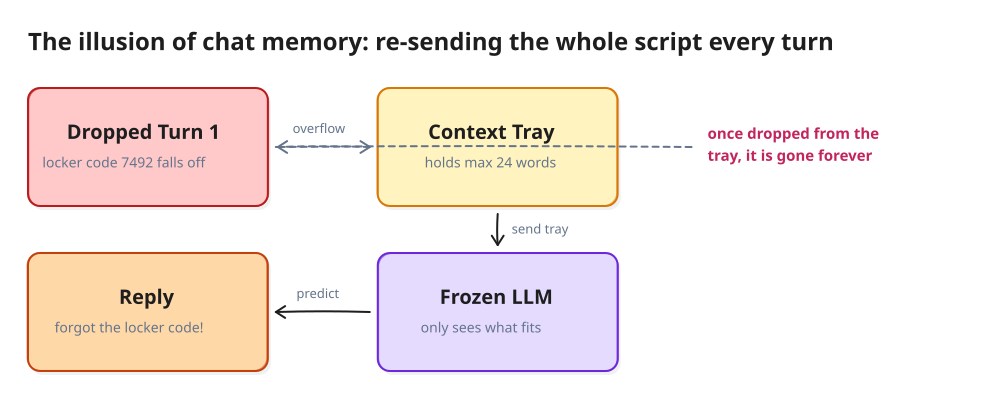
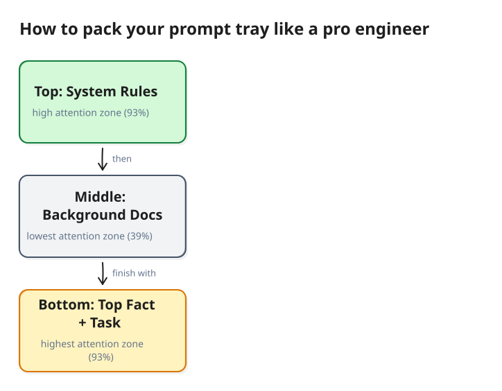

# The context window is your whole memory
*Where does the model keep what you told it two messages ago?*
> **In one line:** An AI has zero memory of your previous message; your chat app secretly pastes your entire conversation history onto a fixed-size lunch tray on every single turn — and anything that falls off the tray or sits in the dead middle gets forgotten.

## Explain it like I'm 12: The Amnesia Chef and the Fixed-Size Lunch Tray

Remember from Checkpoint 1 that the AI's brain is a frozen file on a hard drive? Every time it finishes answering you, it gets **100% total amnesia**. It does not store a file on its server called `'Ashwin's Chat'` inside its neural weights.

Wait — then how does ChatGPT or Claude know what you said two messages ago when you ask a follow-up question?

Because your chat app plays a sleight-of-hand trick! Every time you hit **Send**, the app takes your entire chat history from the very first message, glues your new line onto the bottom, and places the whole stack onto a fixed-size tray called the **context window** in plain words: the maximum number of tokens (input prompt + generated reply combined) the model can hold and look at in a single pass.

Look at `Figure 1` from our lab. Our toy tray holds at most **24 words**. In Turn 1, you tell the AI: `'My secret locker code is 7492.'` By Turn 5, after chatting about the cafeteria menu and robotics club, the conversation is 43 words long. To fit the new question onto the 24-word tray, the app silently shoves Turns 1, 2, and 3 off the back of the tray (**truncation**). When Turn 5 asks `'What was my secret locker code?'`, the AI has no idea — because Turn 1 literally isn't on the tray anymore!

*When the tray overflows, the oldest messages at the front get pushed off the edge (truncation).*

## Why you pay for Message 1 ten times in a 10-turn chat

Once you see the lunch tray trick, a big billing mystery makes instant sense.

When you have a 10-message conversation with an AI API:
- On Turn 1, you send 100 tokens.
- On Turn 2, you re-send Turn 1 (100 tokens) + Turn 1's answer (200 tokens) + your new question (100 tokens) = **400 tokens**.
- By Turn 10, you are re-sending and paying for Message 1 for the **tenth time in a row**!

Every token on the tray — both the **prompt** (everything you send in) and the **completion** (every new token the model generates back) — shares the same context window budget.

## Lost in the Middle: Why a giant tray still misses the middle sandwich

Modern models brag about giant trays: 128,000 tokens (a whole 300-page book) or even 1,000,000 tokens. So developers thought: *'Awesome! I'll just paste 50 documents into the prompt and the AI will find the needle in the haystack.'*

Then researchers at Stanford (Liu et al., *Lost in the Middle*) tested where the needle actually sat inside the stack of documents. Look at `Figure 2` from our Python lab:
- When the key fact sat in **Chunk 1/10 (the very beginning)**, recall accuracy was **`93.0%`**.
- When the exact same fact was moved to **Chunk 6/10 (the dead middle)**, recall crashed to **`38.7%`**!
- When the fact was moved to **Chunk 10/10 (right at the bottom next to the question)**, recall jumped right back up to **`93.0%`**.

Just like a human cramming a textbook five minutes before class, the model remembers the first page (**primacy**) and the last page it just read (**recency**), while the middle pages blur together.

*Models remember the start (93.0%) and the end (93.0%) of a long prompt, but drop to 38.7% in the dead middle.*

## How to pack your prompt tray so the AI never misses

Look at `Figure 3`. Knowing the U-curve gives you a concrete layout rule for every production prompt you ever write:

1. **Top of the tray (Chunk 1 — 93% recall):** Put your non-negotiable system role and rules here.
2. **Middle of the tray (Chunks 3–7 — lower recall):** Put lower-ranked background history or older conversation turns here.
3. **Bottom of the tray (Chunk 10 — 93% recall):** Put your **#1 highest-ranked retrieved document** and the **exact user question / output format instruction** at the very bottom of the prompt, right before the model starts generating tokens.

*Put identity and core rules at the very top, reference material in the middle, and the exact question + key facts at the very bottom.*

## Jargon Decoder

| Term | In plain words | Why you care |
|---|---|---|
| **context window** | The fixed-size token tray that holds your entire input prompt plus the model's generated answer in one call. | Your hard ceiling on how much text the model can see at once. |
| **prompt** | All the tokens you place on the tray before the model starts guessing (system rules, history, docs, question). | Because the model is stateless, anything not in the weights or the current prompt does not exist. |
| **completion** | The new tokens generated by the model and added onto the tray. | Completion tokens share the context window limit with your prompt and usually cost 3x–5x more per token. |
| **truncation** | Chopping off the oldest or overflowing tokens when your text exceeds the context window budget. | Silent truncation drops early instructions or facts without throwing an error if you don't budget tokens. |
| **lost in the middle** | The U-shaped accuracy drop where models recall facts at the very start and very end of a long prompt far better than facts in the middle. | Tells you to place your top retrieved facts and final instructions at the very start or very bottom of the prompt. |

## Hands-On Lab: Simulate Sliding Context Truncation & the 'Lost in the Middle' U-Curve

Run a 24-word sliding context window over a 5-turn chat to watch Turn 1's secret locker code ('7492') fall off the tray, then measure the U-shaped recall curve across 10 document positions (93.0% at start/end vs 38.7% in the middle).
