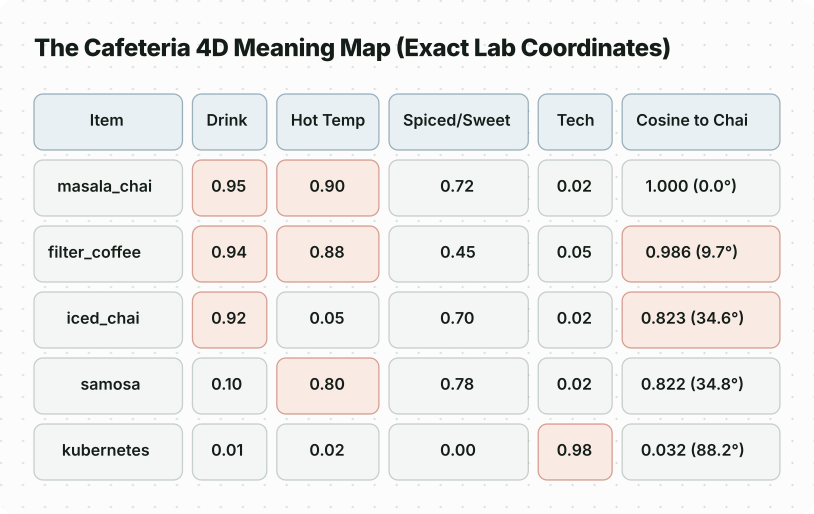
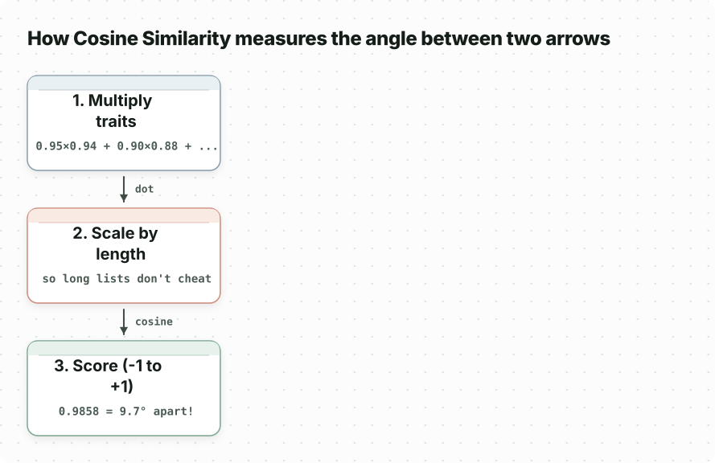

# Embeddings: meaning as coordinates
*How can a machine tell that 'masala chai' and 'filter coffee' are neighbors?*
> **In one line:** An embedding turns a dead barcode number into a GPS coordinate on a giant meaning map, so words that mean similar things sit at nearly the same angle.

## Explain it like I'm 12: Where do you sit in the Campus Cafeteria?

In Lesson 2, the tokenizer handed the brain raw integer IDs (`496`, `15717`). There is a huge problem with raw IDs: they carry **zero meaning**. In a dictionary, barcode `#40,000` (`coffee`) can sit right next to `#40,001` (`coffin`). You cannot subtract `#40,001 - #40,000` and expect sensible math.

Now picture walking into the **Campus Cafeteria**. Imagine the floor has chalk axes painted across it: East–West measures *Drink vs. Food*, North–South measures *Hot vs. Cold*, and height measures *Spiced/Sweet*. Where do **Masala Chai** and **Filter Coffee** land? Practically at the exact same table (`9.7°` apart!). Where does **Kubernetes** land? Out in the Server Room, nearly `90°` away.

That list of coordinates is an **embedding** in plain words: a dense list of floating-point numbers (a **vector**) that maps a token or sentence to a point in meaning space so semantically similar ideas point in the same direction.

**Wait — who scores those sliders?** Nobody hand-types them! During training, the model learns every coordinate automatically using the **distributional hypothesis**: *'You shall know a word by the company it keeps.'* Because `masala chai` and `filter coffee` appear in nearly identical sentences (*'I need a hot cup of ___ before standup'*), gradient descent (and contrastive loss in dedicated embedding models) pulls their arrows together and pushes unrelated sentences apart.

*The embedding table swaps one integer ID for a list of coordinate numbers (a vector).*

## Measuring Meaning with High-School Geometry: Dot Product, Cosine & L2 Norm

In our Python lab (`Figure 2`), every cafeteria item lives on 4 axes: `[drink, hot_temp, sweet_or_spiced, computer_tech]`:
- `masala_chai` → `[0.95, 0.90, 0.72, 0.02]`
- `filter_coffee` → `[0.94, 0.88, 0.45, 0.05]`
- `kubernetes` → `[0.01, 0.02, 0.00, 0.98]`

How does a GPU check if two 1,536-dimensional ideas match in microseconds? It measures the **angle** between their arrows using **cosine similarity** (`-1.0` opposite, `0.0` unrelated 90°, `+1.0` identical direction):

1. **Dot Product (`a · b`):** Multiply matching axes and add them up. Big × Big explodes positively; Big × Tiny (`0.98 × 0.02`) vanishes.
2. **Divide by Both Magnitudes (`||a|| × ||b||`):** Removes arrow length so long documents don't beat short ones just by having larger numbers.
3. **Read the exact lab angles:** `cosine(masala_chai, filter_coffee) = 0.9858` (**9.7° apart!**), while `cosine(masala_chai, kubernetes) = 0.0322` (**88.2° apart — nearly perpendicular!**).

**Why production vector DBs love L2 Normalization:** In Step 4 of our lab, we divide every vector by its own length (`magnitude = 1.0`, called **L2-normalized**). Once vectors have length `1.0`, `dot_product(u, v)` equals `cosine_similarity(u, v)` to **6 decimal places (`0.985850 == 0.985850`)** — letting vector databases skip expensive square-root divisions at query time!

*Chai and coffee align within 9.7° (0.986); iced_chai scores 0.823 (Antonym Trap!); Kubernetes sits 88.2° away (0.032).*

## Directions Are Concepts: Vector Arithmetic (`king - man + woman = queen`)

Embeddings don't just cluster neighbors — **directions in vector space encode relationships**.

In Step 3 of our Python lab, we represent royalty and gender along `[royalty, human_adult, feminine_axis, tech]`:
- `king` = `[0.95, 0.90, 0.05, 0.02]`
- `man` = `[0.05, 0.90, 0.05, 0.02]`
- `woman` = `[0.05, 0.90, 0.95, 0.02]`

Subtract `man` from `king` (stripping away `'adult male'`, leaving the pure `'royalty'` arrow `[+0.90, 0, 0, 0]`), then add `woman`. You land directly on `[0.95, 0.90, 0.95, 0.02]` — matching **`queen`** with cosine similarity **`1.0000`** (beating `prince` at `0.8403` and `woman` at `0.8311`)!

Modern mechanistic interpretability research (sparse autoencoders / steering vectors) uses this exact property: adding a learned 'refusal' or 'Golden Gate Bridge' direction vector inside an LLM's residual stream literally steers its personality in real time.

*Multiply matching traits, add them up, and divide by arrow lengths.*

## How to pick an embedding model in production — and the 3 classic traps

Every RAG pipeline, semantic search engine, and recommendation system runs on embeddings. Three production rules separate hobby demos from reliable systems:

1. **The Antonym Trap (`masala_chai` vs `iced_chai` = `0.8234`!):** Look at Step 2 of our lab: *hot* masala chai and *cold* iced chai still score **`0.8234`** (only `34.6°` apart) because they share the drink and spice axes! In real text, `'I love this product'` and `'I hate this product'` often score `0.80+`. Never rely on raw cosine similarity alone for sentiment or strict yes/no filtering — pair vector retrieval with a **cross-encoder reranker** or LLM judge.
2. **Matryoshka Dimensions (MRL) & Storage Cost:** Modern models (`text-embedding-3-large`, Nomic, BGE-M3) are trained with **Matryoshka Representation Learning**, packing the most important semantic info into the earliest dimensions. You can slice a `3,072`-dim vector down to `512` dims, re-normalize, and save **6× RAM/disk** while keeping ~97% of search quality.
3. **Never mix models (and respect Query vs. Document prefixes):** Coordinate spaces are incompatible across models — upgrading your embedding model requires re-embedding your entire index. Also check whether your model is *asymmetric* (e.g., E5/BGE expect `'query: ...'` vs `'passage: ...'` prefixes so short questions align with long paragraphs).

## Jargon Decoder

| Term | In plain words | Why you care |
|---|---|---|
| **embedding** | A list of numbers that acts as a GPS coordinate for a word or sentence's meaning. | Lets code compare the meaning of two texts using simple multiplication. |
| **vector** | An ordered list of numbers, like [0.95, 0.40, 0.02, 0.88], representing an arrow in space. | Every token inside an LLM travels through every layer as a vector. |
| **dimension** | One number slot (slider) inside a vector that captures a feature or trait. | More dimensions (768 vs 1536 vs 3072) store finer meaning distinctions but take more RAM. |
| **dot product** | Multiplying matching numbers from two vectors and adding the results together. | The single most common math operation in all of AI and GPUs. |
| **cosine similarity** | The dot product divided by the arrow lengths, scoring how closely two vectors align (-1 to +1). | The standard metric used to rank relevant chunks in vector search and RAG. |
| **embedding model** | A specialized neural network whose only job is turning text into meaning coordinates. | Much cheaper and faster than a chat LLM; used to index documents for search. |
| **L2 normalization** | Scaling every vector so its arrow length equals 1.0 without changing its direction. | Makes fast dot product mathematically identical to cosine similarity in vector databases. |
| **static vs. contextual embedding** | Static gives 'bank' one fixed vector; contextual adjusts 'bank' using surrounding words via attention. | Explains why modern sentence embeddings disambiguate 'river bank' vs 'money bank'. |
| **Matryoshka Representation (MRL)** | Training embeddings so the first 256 or 512 numbers already capture most of the meaning, like nesting dolls. | Lets you cut vector database RAM bills by 4×–6× with almost zero accuracy loss. |

## Hands-On Lab: Build a 4D Meaning Map: Cosine Angles, Antonym Trap, Vector Arithmetic & L2 Norm Proof

Compute exact cosine similarities and angles in degrees, observe the Antonym Trap (hot vs iced chai = 0.8234), execute king - man + woman = queen (1.0000), and prove dot_product(L2_norm) == cosine_similarity.
