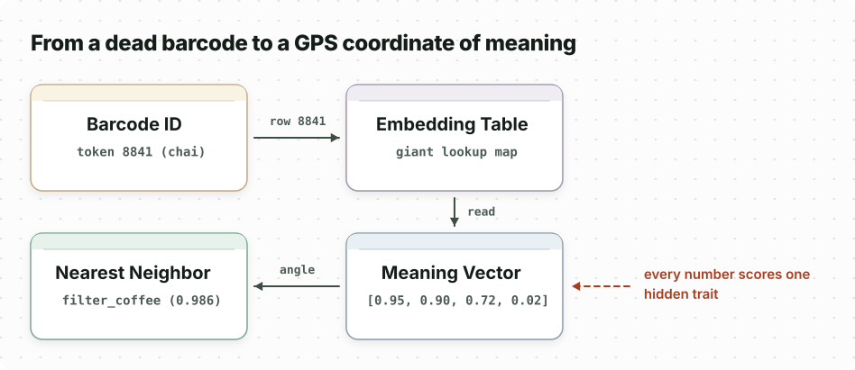

# Embeddings: meaning as coordinates
*How can a machine tell that 'masala chai' and 'filter coffee' are neighbors?*
> **In one line:** An embedding turns a dead barcode number into a GPS coordinate on a giant meaning map, so words that mean similar things sit at nearly the same angle.

## Explain it like I'm 12: Where do you sit in the Campus Cafeteria?

At the end of Checkpoint 2, the barcode scanner turned our words into numbers like `496` and `15717`. But there is a catch: barcode numbers are just random ID tags. In a grocery store, barcode `501` might be apples and barcode `502` might be motor oil. You cannot do math on barcodes to see if two things taste similar.

Now walk into the **Campus Cafeteria**. Imagine the cafeteria floor has two giant chalk lines painted on it:
- **East to West:** How *Hot* vs *Cold* something is.
- **North to South:** How *Sweet* vs *Savory* something is.

If you place every snack on the floor by its two coordinates, where do **Masala Chai** and **Filter Coffee** end up? Right next to each other in the *Hot & lightly sweet* corner! Where does **Mango Lassi** go? Over in the *Cold & very sweet* corner. Where does a **Kubernetes server** go? Outside the cafeteria building altogether.

That list of coordinates is an **embedding** in plain words: a list of numbers (called a **vector**) that places a word or sentence on a multi-dimensional map of meaning so similar ideas sit close together.

*The embedding table swaps one integer ID for a list of coordinate numbers (a vector).*

## From 2 chalk lines to 1,536 sliders (Dimensions & Vectors)

On a flat floor, we only have 2 directions (East-West and North-South). Engineers call each direction a **dimension** in plain words: one numbered slider that measures a single trait.

In our Python lab (`Figure 2` above), we built a **4-dimensional** map with four sliders for every item:
`[warm_drink, sweet_food, computer_tech, morning_energy]`

Look at the coordinates for two items:
- `masala_chai`   → `[0.95, 0.40, 0.02, 0.88]`
- `filter_coffee` → `[0.92, 0.25, 0.05, 0.94]`
- `kubernetes`    → `[0.01, 0.00, 0.98, 0.12]`

Notice how `masala_chai` and `filter_coffee` both have high numbers on slider 1 (`0.95` and `0.92`) and slider 4 (`0.88` and `0.94`), and tiny numbers on slider 3 (`0.02` and `0.05`).

A real frontier **embedding model** (like OpenAI `text-embedding-3` or BGE) works the exact same way — except instead of 4 sliders, it uses **1,536 sliders** learned automatically during training!

*Chai and coffee match on warm_drink and morning_energy; Kubernetes sits alone in computer_tech.*

## How the machine checks if two arrows point the same way (Cosine Similarity)

Once you have two lists of 1,536 numbers, how does the computer calculate a single match score between them in a microsecond?

It draws an arrow from `[0, 0, 0, 0]` to each word's coordinate and measures the angle between the two arrows! Engineers call this **cosine similarity** in plain words: a score from `-1.0` to `+1.0` that measures whether two coordinate arrows point in the exact same direction (`1.0`), at a 90-degree right angle (`0.0`, completely unrelated), or opposite directions (`-1.0`).

Here is the entire 3-step recipe from our 25-line Python lab:
1. **Multiply matching sliders and add them up (Dot Product):**
   `(0.95 × 0.92) + (0.40 × 0.25) + (0.02 × 0.05) + (0.88 × 0.94) = 1.8022`
   Notice why this works: when both words have a big number on the same slider, multiplying two big numbers creates a huge boost. When one is `0.98` and the other is `0.02` (`kubernetes` vs `chai`), `0.98 × 0.02` collapses to almost zero!
2. **Divide by the length of both arrows:** That puts every comparison on a fair scale up to `1.0000`.
3. **Read the result:** In our lab, `cosine(masala_chai, filter_coffee)` is **`0.9924`** (nearly identical direction!), while `cosine(masala_chai, kubernetes)` is **`0.1006`**.

*Multiply matching traits, add them up, and divide by arrow lengths.*

## What embeddings unlock in real apps — and where they break

Every time you see an AI product that says *'Chat with your PDFs'* or *'Search 10,000 customer tickets by meaning'*, it is running the exact cosine-similarity loop you just learned:

1. **Semantic search without matching words.** A user types `'hot morning beverage'`. Even though the words `'masala'` and `'chai'` never appear in the query, the query's coordinate vector lands right next to `[0.95, 0.40, 0.02, 0.88]` and retrieves `masala_chai` at the top of the list.
2. **The Antonym Trap (Why 'I love this' and 'I hate this' sit close together!).** Here is a trap that catches senior engineers: on an embedding map, *opposites* like `'hot'` and `'cold'` or `'love'` and `'hate'` often have high cosine similarity (`0.80+`)! Why? Because they appear in the exact same sentences (*'The tea is too hot/cold'*) and share 95% of the same topic sliders (temperature, drink, feeling). Never trust raw embedding similarity alone to tell `'yes'` from `'no'`.
3. **Never mix coordinates from two different models.** An embedding from Model A (`1536` sliders) and Model B (`768` sliders) have completely different slider meanings. If you upgrade your embedding model, you must re-embed your entire database.

## Jargon Decoder

| Term | In plain words | Why you care |
|---|---|---|
| **embedding** | A list of numbers that acts as a GPS coordinate for a word or sentence's meaning. | Lets code compare the meaning of two texts using simple multiplication. |
| **vector** | An ordered list of numbers, like [0.95, 0.40, 0.02, 0.88], representing an arrow in space. | Every token inside an LLM travels through every layer as a vector. |
| **dimension** | One number slot (slider) inside a vector that captures a feature or trait. | More dimensions (768 vs 1536 vs 3072) store finer meaning distinctions but take more RAM. |
| **dot product** | Multiplying matching numbers from two vectors and adding the results together. | The single most common math operation in all of AI and GPUs. |
| **cosine similarity** | The dot product divided by the arrow lengths, scoring how closely two vectors align (-1 to +1). | The standard metric used to rank relevant chunks in vector search and RAG. |
| **embedding model** | A specialized neural network whose only job is turning text into meaning coordinates. | Much cheaper and faster than a chat LLM; used to index documents for search. |

## Hands-On Lab: Build a 4D Meaning Map & Rank Nearest Neighbors with Cosine Similarity

Implement dot product, vector magnitude, and cosine similarity in pure Python, and prove mathematically why 'masala_chai' matches 'filter_coffee' (0.9924) while rejecting 'kubernetes' (0.1006).
