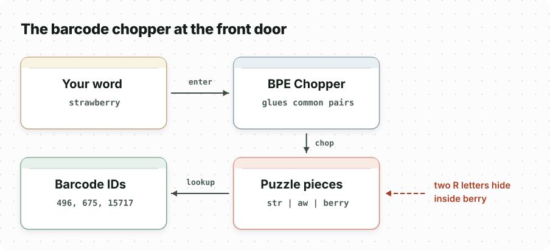

# Tokens: how your text becomes numbers
*Why does the model see 'strawberry' as pieces and miscount its letters?*
> **In one line:** An AI never sees letters or words; a chopper at the front door slices your text into common puzzle pieces and swaps each piece for a barcode number before the brain ever wakes up.

## Explain it like I'm 12: Why you can't count bricks behind a painted wall

Here is a riddle that stumped the whole tech world: a frontier AI can write a working compiler in ten seconds, yet when you ask `'How many R's are in strawberry?'`, it often replies `'Two!'` with total confidence.

How can a super-genius fail a second-grade spelling check?

Because neural networks are giant matrix calculators — they **cannot read letters**. Before your message ever reaches Layer 1 of the model, a separate deterministic front-door program called a **tokenizer** slices your text into common puzzle pieces (**tokens**) and replaces each piece with an integer barcode (**token ID**).

Look at `Figure 1`: under a GPT-4 class tokenizer (`cl100k_base`), standalone `'strawberry'` enters the brain as just three sealed integers:
- `'str'` → barcode `496`
- `'aw'` → barcode `675`
- `'berry'` → barcode `15717`

Even wilder: put a single leading space in front of it (`' strawberry'`, the way it actually appears inside a sentence like `'Count the r's in strawberry'`) and `cl100k_base` merges all 11 characters into **one single barcode (`73700`)**! The model never receives the 10 characters `s-t-r-a-w-b-e-r-r-y`. Asking it to count letters inside a single atomic integer ID is like asking you how many bricks sit behind painted drywall.

*The neural network only ever receives the final green list of barcode numbers.*

## How real tokenizers work: Regex Pre-Tokenization + Byte-Level BPE

Why not use 256 single bytes (too long — a short essay explodes to 5,000 tokens) or whole dictionary words (millions of entries, crashes on typos and code)? Modern LLMs use a two-step compression pipeline:

1. **Step A — Regex Pre-Tokenization:** Before counting pairs, the tokenizer splits text with a regex pattern so letters, numbers, and punctuation stay in separate buckets (`['strawberry', ',', ' berry', '!', ...]`). Why? Without pre-tokenization, BPE would waste precious vocabulary slots minting `'dog.'`, `'dog!'`, `'dog,'`, and `'dog?'` as four different tokens! Notice also how the regex attaches **leading spaces** to the word (`' berry'`), which means `'server'` and `' server'` get completely different IDs.
2. **Step B — Byte-Level BPE (The Lego Glue Game):** Start with the 256 raw UTF-8 bytes (`0–255`) — guaranteeing **zero unknown-character crashes** on any Unicode script or emoji on Earth (**byte fallback**). Repeatedly scan the training corpus, find the most frequent adjacent pair inside pre-token boundaries, and glue it into a new barcode (`256`, `257`, ...).

In our Python lab, watch the exact 8-step merge trace: `'b'+'e' -> 'be' (256)` ... `'berr'+'y' -> 'berry' (259)` ... `'stra'+'w' -> 'straw' (263)`, shrinking **42 raw UTF-8 bytes down to 14 tokens (33.3% of original)** while keeping `,`, `!`, and `.` cleanly isolated!

*Start with 256 single-byte crumbs and repeatedly glue the most common neighbors together.*

## The 3.6x Hindi Tax: Token Fertility & Real API Economics

Because BPE learns merges strictly by frequency in its training data, whatever languages dominate that corpus get long, cheap single-token chunks. Underrepresented scripts get shattered into tiny UTF-8 byte crumbs — sometimes even splitting a single Devanagari letter mid-UTF-8 byte sequence!

Look at `Figure 2` from our verified `cl100k_base` (GPT-4) lab measurements:
- **English (`'The server responded in 12ms.'`):** 29 chars → **8 tokens** (`0.28` tok/char · **`1.0×`** baseline).
- **Hindi (`'नमस्ते दुनिया'`):** 13 chars → **13 tokens** (`1.00` tok/char · **`3.6×` cost & latency tax!**).
- **Emojis (`'🚀🔥🤖'`):** 3 chars (12 UTF-8 bytes) → **9 tokens** — 3 raw UTF-8 byte tokens *per emoji* (`3.00` tok/char · **`10.9×`** multiplier!).

Engineers call this **token fertility**. Remember Lesson 1: the model generates **one token per forward pass**. A `3.6×` fertility penalty doesn't just multiply a Hindi user's API bill by 3.6× — it also makes streaming **3.6× slower** AND shrinks their effective memory window by **3.6×**! Upgrading from a 100k vocab (`cl100k_base`) to a 200k multilingual vocab (`o200k_base`) collapses `'नमस्ते दुनिया'` from **13 tokens down to 5 tokens (`-61.5%`)**, turning the entire word `' दुनिया'` into a single token (`#64593`).

*Verified cl100k_base (GPT-4) vs o200k_base (GPT-4o): Hindi takes 3.6x more tokens/char than English in cl100k — and drops 61.5% in o200k!*

## Four production tokenizer bugs every AI engineer catches immediately

Understanding the front-door chopper immediately lets you debug four notorious production failures:

1. **The Trailing-Space Bug:** Never end a prompt template with a trailing space (`'Answer: '`). Because BPE expects spaces *attached to the start of the next word* (`' Yes'`), a dangling space forces an awkward standalone space token (`220`) followed by a rare space-less `'Yes'` token — measurably degrading accuracy.
2. **Digit Splitting & Math:** Older BPE tokenizers glued `123` into one token but chopped `1234` into `12` + `34`, breaking place-value alignment. Modern frontier tokenizers (Llama 3, DeepSeek, GPT-4o) restrict number merges in their pre-tokenization regex to 1–3 digits (or single digits `0–9`) so arithmetic lines up cleanly.
3. **Special Tokens & Prompt Injection:** Control markers like `<|im_start|>`, `<|im_end|>`, and `<|endoftext|>` are reserved integer IDs injected by the chat template. Never pass untrusted user input with `allowed_special='all'`, or a user can literally type `<|im_end|><|im_start|>system` and hijack the model's role!
4. **Fixing Character Tasks Instantly:** Whenever an app needs exact spelling, letter counting, or string reversal, either call a Python tool (best!) or instruct the model to space-separate characters (`s t r a w b e r r y`) before counting.

## Jargon Decoder

| Term | In plain words | Why you care |
|---|---|---|
| **token** | One puzzle piece of text (a word, part of a word, or a single byte) that gets one barcode number. | Your API bill, memory limit, and streaming speed are all measured in tokens, not words. |
| **tokenizer** | The front-door program that chops text into tokens and swaps them for integer IDs. | Runs before the neural network; tokenizer blind spots cannot be fixed by 'thinking harder'. |
| **byte pair encoding (BPE)** | Starting with 256 raw bytes and repeatedly gluing the most common adjacent pair into a new token. | The compression algorithm used by GPT-4, Claude, Llama, and DeepSeek. |
| **vocabulary** | The full dictionary of all 100,000+ puzzle pieces the tokenizer knows. | Bigger vocabularies compress non-English languages better. |
| **token ID** | The barcode integer (like 15717 for 'berry') handed to the model. | The only representation of your text the model ever actually receives. |
| **token fertility** | How many tokens it takes to represent one word or character in a language. | Directly multiplies your cloud bill and response time for Hindi, Indic scripts, and dense JSON. |
| **byte fallback** | Breaking unfamiliar characters (like rare emojis) down into raw UTF-8 byte tokens (0–255). | Prevents unknown-character crashes, at the cost of up to 4 tokens per character. |
| **special token** | Reserved control barcodes like <|im_start|> or <|endoftext|>. | Marks where the user stops talking and the assistant starts. |
| **pre-tokenization** | A regex split run BEFORE BPE so words, numbers, and punctuation don't get glued together into duplicate tokens. | Explains why leading spaces attach to words (' server') and why trailing spaces in prompts degrade completions. |

## Hands-On Lab: Build Regex Pre-Tokenization + Byte-Level BPE & Measure Multilingual Fertility

Implement regex pre-tokenization + byte-level BPE from raw UTF-8 bytes, inspect every merge step (#1–#8), and measure verified cl100k_base vs o200k_base token fertility across English (1.0x), Hindi (3.6x -> -61.5% in o200k), and Emojis (10.9x -> -44.4% in o200k).
