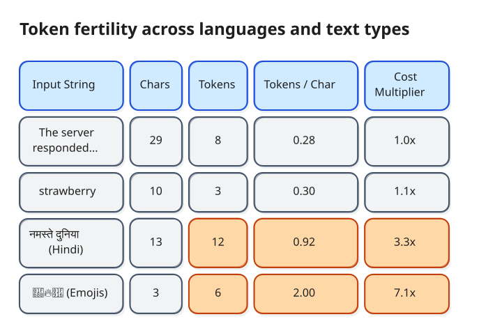

# Tokens: how your text becomes numbers
*Why does the model see 'strawberry' as pieces and miscount its letters?*
> **In one line:** A model never sees letters or words; a tokenizer chops your string into frequent subword chunks and replaces each chunk with an integer ID before the neural network ever runs.

## Why this matters to you as a builder

Every LLM API bills you by the token, caps your memory by the token, and thinks by the token. If you treat tokens as words, three production bugs will blindside you:

- **Your non-English users pay 3x to 5x more and get slower answers.** Because every generated token requires one full forward pass of the model, a Hindi sentence that takes 3.3x more tokens than English also takes 3.3x longer to stream.
- **Character-level prompts fail silently.** Asking an LLM to count letters, check spelling, or parse unspaced IDs fails because the model cannot see inside a merged token ID without extra reasoning steps.
- **Leading spaces and formatting change what the model sees.** In modern tokenizers, `'server'` and `' server'` (with a leading space) are two completely different integer IDs.

## The everyday version: shipping Lego sub-assemblies instead of loose bricks

Imagine shipping Lego kits. If you ship every kit as tiny 1x1 studs (raw characters), a castle takes 50,000 pieces and the instruction book is endless. If you pre-glue entire castles (whole words), you need a warehouse with a million unique molds and you still cannot build a new shape.

A **tokenizer** in plain words: a deterministic lookup program that slices text into frequent subword chunks and maps each chunk to an integer ID. Common words like `' server'` travel as one pre-assembled block (`3585`). Rare or compound words like `'strawberry'` get snapped into three standard blocks: `'str'` (`496`), `'aw'` (`675`), and `'berry'` (`15717`).

*The neural network only ever sees the final green array of integer IDs.*

## Level 1: The vocabulary of tokenization

Let's define the six terms that show up in every tokenizer spec:

- **token** in plain words: one atomic chunk of text (a word, part of a word, or a single byte) that maps to one integer ID.
- **vocabulary** in plain words: the fixed dictionary of all token chunks the model knows (typically 50,000 to 200,000 entries).
- **token ID** in plain words: the index number of a token in that vocabulary (`0` up to `vocab_size - 1`).
- **byte pair encoding (BPE)** in plain words: a compression algorithm that starts with individual bytes and repeatedly merges the most frequent adjacent pair into a new token.
- **special token** in plain words: a reserved control ID like `<|endoftext|>` or `<|im_start|>` that signals turn boundaries or tool calls rather than human text.

*Start with 256 raw bytes and repeatedly mint a new ID for the most common adjacent pair.*

## Level 2: How Byte Pair Encoding compresses text in 4 steps

In our lab, we trained a tiny BPE tokenizer on `'strawberry berry straw berry strawberry'` (39 UTF-8 bytes). Here is the exact loop:

1. **Start with raw UTF-8 bytes.** Every string is first converted into a list of bytes (`0` to `255`). Because every character in every language is valid UTF-8, a byte-level BPE tokenizer never hits an `<UNK>` (unknown) token.
2. **Count every adjacent pair.** Scan the sequence and count which two IDs sit next to each other most often.
3. **Mint a new token ID for the winner.** Replace every occurrence of the winning pair with ID `256` and add `256` to the vocabulary dictionary. After just 8 merges in our lab, our 39-byte sequence compressed down to **11 tokens (28.2% of original length)**.
4. **Freeze the merge table.** Once the vocabulary hits its target size (e.g., 100,277 tokens in `cl100k_base`), training stops. At inference time, the tokenizer applies those frozen merge rules in order.

*Real numbers from our lab: Hindi costs 3.3x more tokens per character than English.*

## Level 3: Pro mode — token fertility, glitch tokens, and arithmetic traps

When you inspect a production system through the tokenizer lens, three high-leverage patterns emerge:

1. **Token fertility is a hidden tax on non-English and JSON.** **Token fertility** in plain words: the average number of tokens required to represent one word or character. In our lab, English prose took `0.28` tokens/char, Hindi (`'नमस्ते दुनिया'`) took `0.92` tokens/char (**3.3x cost and latency multiplier**), and emojis took `2.00` tokens/char (**7.1x multiplier**) because multi-byte UTF-8 sequences fall back to raw byte tokens.
2. **The 'strawberry' blindness fix.** Why does an LLM miscount the `'r'`s in `'strawberry'`? Because it sees `[496, 675, 15717]`. If you ask it to spell the word out with spaces first (`'s t r a w b e r r y'`), each letter is forced into its own separate token ID, and accuracy jumps to 100%.
3. **Digit splitting in arithmetic.** If a tokenizer merges `123` into one token on one number, but splits `1234` into `12` and `34` on the next, the model sees inconsistent place values. Modern models (like Llama 3 and DeepSeek) explicitly force single-digit or 3-digit token rules to make arithmetic predictable.

## Jargon Decoder

| Term | In plain words | Why you care |
|---|---|---|
| **token** | The smallest chunk of text an LLM processes as a single step. | Your API bill, context limit, and generation speed are all measured in tokens, not words. |
| **tokenizer** | The deterministic pre-processor that converts strings to integer IDs and back. | Runs outside the neural network; bugs here cannot be fixed by prompting alone. |
| **byte pair encoding (BPE)** | Iteratively merging the most frequent adjacent byte pairs into subword tokens. | The standard algorithm behind GPT-4, Claude, and Llama tokenizers. |
| **vocabulary** | The complete lookup table mapping token strings/bytes to integer IDs. | Larger vocabularies (100k–200k) compress multilingual text better but enlarge the model's output layer. |
| **token ID** | The integer index representing one vocabulary entry. | What actually crosses the boundary into the first embedding layer of the LLM. |
| **special token** | Reserved control tokens like <|im_start|> or <|endoftext|>. | If user input contains raw special-token strings and isn't sanitized, users can spoof system turns. |
| **token fertility** | How many tokens a tokenizer produces per word or character. | Directly multiplies your latency and cloud bill for Hindi, Indic languages, code, or dense JSON. |
| **byte fallback** | Representing unfamiliar characters as raw UTF-8 byte tokens (0–255). | Prevents crashes on rare emojis, but explodes token count (up to 4 tokens per character). |

## Hands-On Lab: Train a 30-line BPE Tokenizer & Measure Multilingual Token Fertility

Implement Byte Pair Encoding from raw UTF-8 bytes, watch 8 merges compress a corpus to 28.2% of its byte length, and measure the exact tokens/char cost multiplier across English, Hindi, and emojis.
