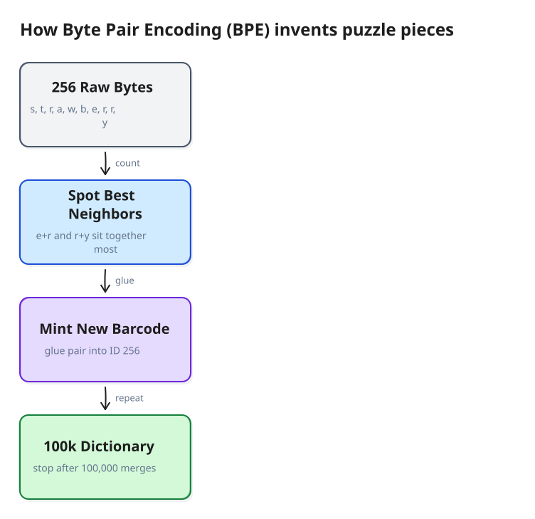

# Tokens: how your text becomes numbers
*Why does the model see 'strawberry' as pieces and miscount its letters?*
> **In one line:** An AI never sees letters or words; a chopper at the front door slices your text into common puzzle pieces and swaps each piece for a barcode number before the brain ever wakes up.

## Explain it like I'm 12: Why you can't count bricks inside a painted wall

Here is a famous riddle: if you ask a billion-dollar AI to write a video game in Python, it can do it in ten seconds. If you ask it `'How many R's are in the word strawberry?'`, it often confidently says `'Two!'`

How can a genius machine fail a second-grade spelling question?

Because the AI **cannot read letters**. Neural networks are giant calculators that only eat numbers. So before your message ever reaches the AI's brain, a small program at the front door called a **tokenizer** chops your sentence into common puzzle pieces (**tokens**) and swaps each piece for a barcode number (**token ID**).

Look at `Figure 1` above. When `'strawberry'` walks through the front door, the chopper snaps it into three puzzle pieces:
- `'str'` → barcode `496`
- `'aw'` → barcode `675`
- `'berry'` → barcode `15717`

The AI's brain never sees the letters `b-e-r-r-y`. It just gets handed box number `15717`. Asking it how many `r`'s are inside `15717` without opening the box is like asking you how many red bricks are hidden behind a painted drywall.

*The neural network only ever receives the final green list of barcode numbers.*

## How the chopper decides where to cut: The Lego glue game (BPE)

Why did the chopper cut `'strawberry'` into `'str'`, `'aw'`, and `'berry'` instead of whole words or single letters?

Think about packing Lego bricks into boxes:
- If you keep every single 1x1 Lego stud loose (**character level**), your dictionary is tiny (just 256 basic computer bytes), but a single book page takes 3,000 studs and the AI's memory fills up immediately.
- If you pre-glue every word in the world (**word level**), you need millions of boxes, and the moment someone types a new slang word or typo, the machine crashes.

So engineers use a clever middle path called **byte pair encoding (BPE)** in plain words: start with tiny single-byte letters, find the two neighbors that sit next to each other most often across thousands of books, and glue them into a new puzzle piece. Repeat 100,000 times.

In our Python lab, we ran just **8 rounds** of BPE glue on `'strawberry berry straw berry strawberry'`. Those 8 merges shrank 39 raw bytes down to **11 puzzle pieces (28.2% of the original size)**!

*Start with 256 single-byte crumbs and repeatedly glue the most common neighbors together.*

## The 3.3x Hindi Tax: Why some languages pay triple at the gate

Because the BPE glue game is played mostly on English websites and Python code, English words get glued into big, cheap single-token pieces (`' responded'` = 1 token). What happens when you type in Hindi or use emojis?

Look at `Figure 2` from our lab output:
- **English (`'The server responded in 12ms.'`):** 29 letters → **8 tokens** (`0.28` tokens per letter).
- **Hindi (`'नमस्ते दुनिया'`):** 13 letters → **12 tokens** (`0.92` tokens per letter — **3.3x more tokens per letter!**).
- **Emojis (`'🚀🔥🤖'`):** 3 emojis → **6 tokens** (`2.00` tokens per character — **7.1x more!**).

Engineers call this ratio **token fertility** in plain words: how many tokens a tokenizer needs to represent one word or character. Because the AI's conveyor belt (from Checkpoint 1) generates **one token per loop**, 3.3x more tokens means a Hindi user pays **3.3x more money** and waits **3.3x longer** for the exact same answer!

*Real measurements from our lab: Hindi takes 3.3x more tokens per character than English.*

## Three pro tricks every AI engineer keeps in their pocket

Once you understand the barcode chopper, three mysterious bugs become easy to fix:

1. **Fixing the 'strawberry' blind spot.** If you ask the AI to *'spell the word with spaces between every letter first (`s t r a w b e r r y`), then count the R's'*, the spaces force the chopper to give every letter its own separate barcode (`436` for `' r'`). Now the AI sees three `436` barcodes in plain sight and counts them with 100% accuracy.
2. **Why leading spaces matter.** To the chopper, `'server'` (at the start of a line) and `' server'` (after a space) have two completely different barcode numbers! If you end your prompt template with a trailing space, the model's next-token scoreboard shifts unexpectedly.
3. **Why numbers trip up math.** If a chopper glues `123` into one token on line one, but chops `1234` into `12` and `34` on line two, the model cannot line up the ones, tens, and hundreds columns. Newer models force every digit `0–9` to be its own token so arithmetic stays consistent.

## Jargon Decoder

| Term | In plain words | Why you care |
|---|---|---|
| **token** | One puzzle piece of text (a word, part of a word, or a single byte) that gets one barcode number. | Your API bill, memory limit, and streaming speed are all measured in tokens, not words. |
| **tokenizer** | The front-door program that chops text into tokens and swaps them for integer IDs. | Runs before the neural network; tokenizer blind spots cannot be fixed by 'thinking harder'. |
| **byte pair encoding (BPE)** | Starting with 256 raw bytes and repeatedly gluing the most common adjacent pair into a new token. | The compression algorithm used by GPT-4, Claude, Llama, and DeepSeek. |
| **vocabulary** | The full dictionary of all 100,000+ puzzle pieces the tokenizer knows. | Bigger vocabularies compress non-English languages better. |
| **token ID** | The barcode integer (like 15717 for 'berry') handed to the model. | The only representation of your text the model ever actually receives. |
| **token fertility** | How many tokens it takes to represent one word or character in a language. | Directly multiplies your cloud bill and response time for Hindi, Indic scripts, and dense JSON. |
| **byte fallback** | Breaking unfamiliar characters (like rare emojis) down into raw UTF-8 byte tokens (0–255). | Prevents unknown-character crashes, at the cost of up to 4 tokens per character. |
| **special token** | Reserved control barcodes like <|im_start|> or <|endoftext|>. | Marks where the user stops talking and the assistant starts. |

## Hands-On Lab: Train a 30-line BPE Tokenizer & Measure Multilingual Token Fertility

Implement Byte Pair Encoding from raw UTF-8 bytes, watch 8 merges compress a corpus to 28.2% of its byte length, and measure the exact tokens/char cost multiplier across English, Hindi, and emojis.
