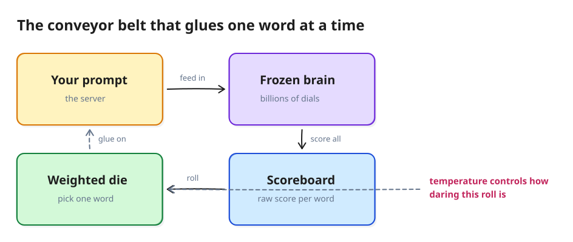
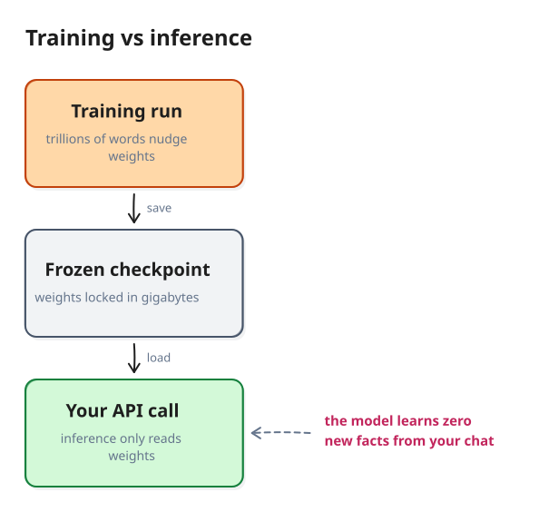
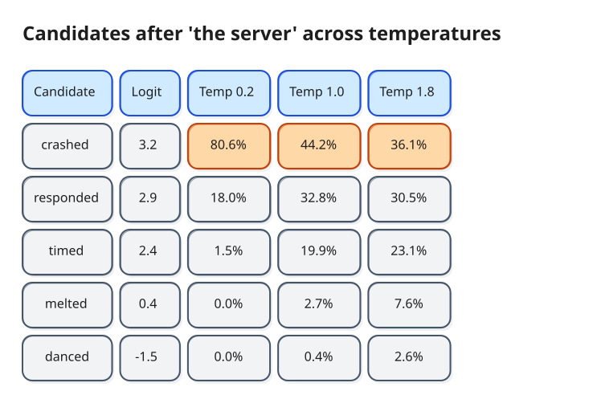

# What an LLM actually is
*What is the model really doing when it answers you?*
> **In one line:** An LLM does not look up answers or plan sentences ahead of time; it scores every possible next word in its dictionary, rolls a weighted die to pick one, glues that word onto your prompt, and starts over from scratch.

## Explain it like I'm 12: The world's fastest one-word relay game

Imagine you are playing a game with a friend who has read every book in the school library. You write two words on a slip of paper: `the server`.

Your friend is only allowed to write **one single word** on the slip and hand it back. They look at `the server`, quickly score every word in the dictionary, write `crashed` at the end, and slide the paper back across the desk.

Now the slip says `the server crashed`. Here is the secret: your friend immediately gets amnesia about *why* they picked `crashed`. For the next word, they pick up the slip (`the server crashed`) from scratch, score the entire dictionary all over again, and write `because`.

How does the game ever end? Inside the dictionary sits a special invisible finish-line word called **`<|eos|>` (End of Sequence)**. At every single tick, `<|eos|>` competes on the scoreboard alongside normal words. The moment the weighted die lands on `<|eos|>`, the relay stops and hands you the finished reply.

That loop — *score every possible next piece of text, pick one, glue it onto the end, repeat until `<|eos|>`* — is **autoregressive next-token prediction**, and it is literally the entire outer loop of every modern **large language model**.

*Every single word the AI picks gets glued back onto your prompt for the next pass.*

## Why it answers your question instead of continuing it (Pre-Training → Post-Training)

Wait — beginners always ask the sharpest follow-up question right here: *'If an LLM is just guessing the next word from internet text, why does it answer `What is the capital of France?` instead of continuing with `2. What is the capital of Spain?` like a quiz worksheet?'*

Because a finished AI assistant goes through **three distinct stages** before its dials are frozen into a read-only file:

1. **Pre-Training (Base Model):** The model reads trillions of tokens of web text, code, and books, nudging billions of internal number dials (**parameters**) to minimize next-token prediction error. A raw *Base Model* really WOULD continue your question with more quiz questions!
2. **Post-Training (SFT + RLHF / RLVR):** Engineers wrap conversations in a structured **chat template** (`<|user|> ... <|assistant|>`) and train the model on curated Q&A examples (**Supervised Fine-Tuning**), followed by **Reinforcement Learning** (human preference feedback or verifiable rewards on math/code) so that the highest-scoring tokens right after `<|assistant|>` are helpful, truthful answers ending with `<|eos|>`.
3. **Inference (Frozen Weights):** When training finishes, those billions of numbers (**weights**) are saved to disk and glued shut. During your chat (**inference**), your prompt passes through the frozen weights without changing a single dial — which is why opening a brand-new chat tomorrow starts with zero memory of you.

*Training adjusts the dials once at massive cost. Your chat happens on a frozen copy.*

## Inside the scoreboard: Logits, Softmax, Temperature & Top-P

If the weights are frozen, why can the exact same prompt produce five different replies? Because the neural network does not output a word — it outputs a raw scoreboard of **logits** across its entire vocabulary (100,000+ tokens), and a tiny **sampler** turns that scoreboard into a roll of a weighted die.

Trace the exact numbers from our Python lab after `the server` (`crashed: 3.2`, `responded: 2.9`, `timed: 2.4`, `melted: 0.4`, `danced: -1.5`):

1. **Scale by Temperature (`z / T`):** Divide every raw logit by **temperature**. Dividing by `0.2` multiplies every gap by `5×` (`3.2 - 2.9 = 0.3` stretches to `1.5`), making the leader crush the runner-up. Dividing by `1.8` shrinks gaps so underdogs rise.
2. **Numerically Stable Softmax:** Raw logits can be negative (`-1.5`). **Softmax** applies `e^(z_i - max_z)` and divides by the sum so all entries sit in `[0, 1]` and total `100%`. Subtracting `max_z` doesn't change a single percentage, yet prevents `math.exp()` from overflowing to `Infinity` on huge logits.
3. **Watch the shift (`Figure 2`):** At Temp `0.2`, `crashed` grabs **`80.6%`** and `danced` drops to **`0.0%`**. At Temp `1.0`, `crashed` is **`44.2%`** and `responded` is **`32.8%`**. At Temp `1.8`, `danced` climbs to **`2.6%`**.
4. **Trim the crazy tail with Top-P (Nucleus Sampling):** On a real 100,000-word vocabulary, even a `0.001%` tail adds up to bizarre hallucinations at high temperature. **Top-P (`0.90`)** sorts tokens from highest to lowest, keeps only the smallest top group summing to `90%`, deletes the weird tail (`danced` vanishes to `0%`!), and re-normalizes the survivors.

*Real numbers from our 40-line Python lab: low temperature locks onto the #1 word, high temperature lets underdogs win.*

## The Snowball Trap: How forward-only prediction breaks real production prompts

Once you truly internalize the one-word conveyor belt, you immediately spot the #1 mistake developers ship in production.

Suppose a team writes a classifier prompt: `'Output YES or NO on line 1, then explain your reasoning on line 2.'`

Imagine the true answer is `NO`, so the scoreboard gives `NO` `75%` and `YES` `25%`. At `temperature = 1.0`, one in four calls rolls the `25%` underdog and emits `YES` on token 1.

Now `YES` is glued onto the slip of paper! On token 2, the model reads `Answer: YES. Explanation:` and asks: *what tokens statistically follow an answer that already declared YES?* Because the conveyor belt has **no backspace key**, it is trapped into rationalizing a wrong verdict.

**The pro fix (Reason-Before-Verdict):** Always put your structured scratchpad or `reasoning` JSON field *before* the final `verdict` field. By the time the die rolls for `YES` or `NO`, the evidence is already sitting on the prompt slip — and that exact insight is why modern reasoning models (o3, DeepSeek-R1, Claude extended thinking) spend tokens thinking *before* emitting the final answer.

## Jargon Decoder

| Term | In plain words | Why you care |
|---|---|---|
| **large language model (LLM)** | A neural network trained on massive text that scores every possible next word. | Reminds you it is a pattern-completion relay engine, not an oracle or database. |
| **next-token prediction** | Guessing the single next piece of text given all the pieces before it. | Explains why word order in your prompt changes quality: the model cannot plan backwards. |
| **parameters** | The adjustable number dials inside the neural network. | More parameters (8B vs 70B) store subtler patterns, at higher memory and latency cost. |
| **weights** | The exact frozen numbers saved inside the parameters after training. | Weights are read-only during your chat; the model learns zero permanent facts from your prompt. |
| **training** | Showing the model trillions of words and nudging weights to shrink prediction mistakes. | Where the model's baseline knowledge and cutoff date come from. |
| **inference** | Running your prompt through the frozen weights to generate words. | What you actually pay for per million tokens when your app is live. |
| **logits** | The raw scoreboard numbers the model gives every word before turning them into percentages. | Every decoding control (temperature, top-p, JSON schemas) works by editing logits before rolling. |
| **softmax** | The formula that converts raw positive or negative logits into percentages summing to 100%. | Shows why runner-up words still have a chance to be picked when temperature > 0. |
| **temperature** | A divisor on logits before softmax that sharpens (0.2) or flattens (1.8) the odds. | Your main dial between repeatable greedy answers (0.0) and creative variety (1.0). |
| **top-p (nucleus sampling)** | Keeping only the smallest set of top-ranked tokens whose probabilities add up to P (e.g. 90%), cutting off bizarre tail words. | Lets you keep answers lively without ever rolling a 0.1% nonsense word from a 100k vocabulary. |
| **<|eos|> (stop token)** | A special finish-line token in the vocabulary that tells the generation loop to stop. | Explains why models naturally finish replies — and why hitting max_tokens cuts sentences off mid-word. |
| **base vs. instruct model** | Base models only continue text like autocomplete; Instruct/Chat models are post-trained (SFT + RL) to follow instructions. | Never send a raw chat prompt to a base model and expect assistant behavior. |

## Hands-On Lab: Build the 60-line Autoregressive Loop: Softmax, Temperature, Top-P & Stop Token

See exact softmax probabilities across Temp 0.2/1.0/1.8, watch Top-P (0.90) chop off the weird tail ('danced'), and verify how <|eos|> terminates generation while Temp 0.0 gives 1/5 unique outputs vs Temp 1.0's 5/5 branching runs.
